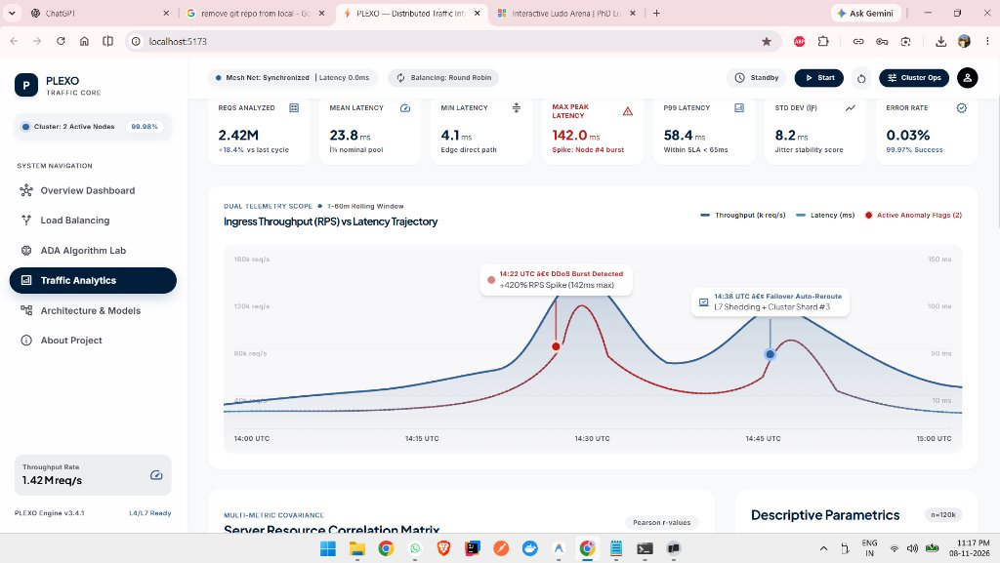
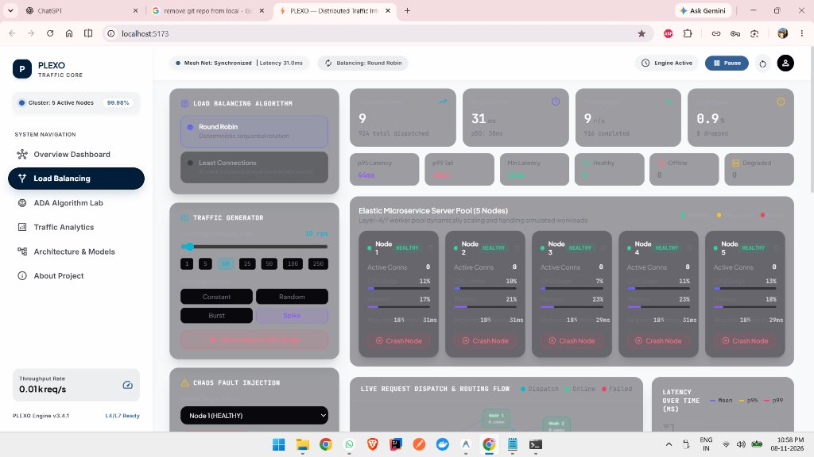
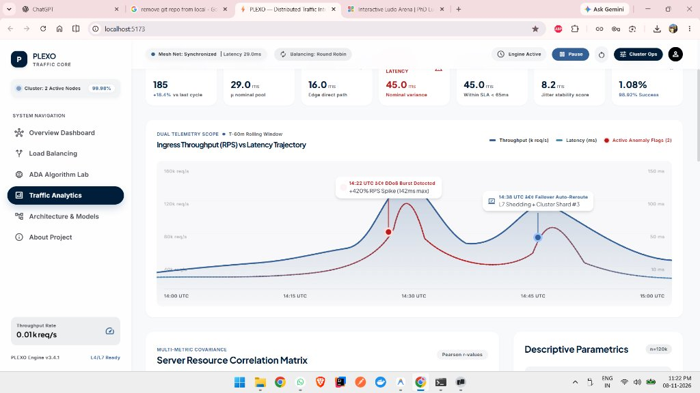
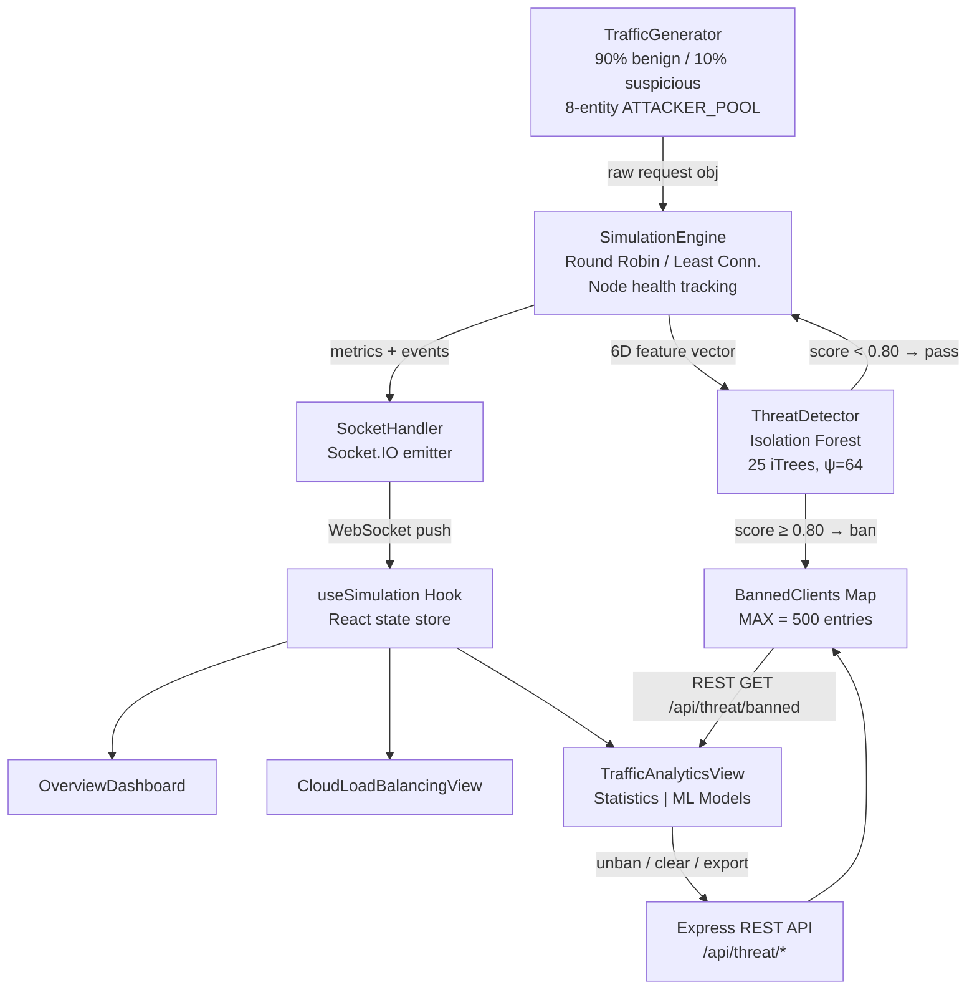

<div align="center">

# 🌊 PLEXO Traffic Core
### Distributed Load Balancer Simulator with ML-Based Threat Detection

[](https://react.dev/)
[](https://www.typescriptlang.org/)
[](https://nodejs.org/)
[](https://socket.io/)
[](https://vitejs.dev/)
[](https://tailwindcss.com/)
[](https://jestjs.io/)

> **A production-grade, full-stack real-time distributed load balancer simulator integrating classical routing algorithms, advanced data structures, and unsupervised machine learning threat detection — built as a postgraduate research capstone.**

</div>

---

## 📌 Table of Contents

1. [Project Overview](#-project-overview)
2. [Screenshots & Live Preview](#-screenshots--live-preview)
3. [System Architecture](#-system-architecture)
4. [Pages & Features — Complete Reference](#-pages--features--complete-reference)
   - [Overview Dashboard](#1-overview-dashboard)
   - [Cloud Load Balancing](#2-cloud-load-balancing-simulator)
   - [ADA Algorithm Lab](#3-ada-algorithm-lab)
   - [Traffic Analytics](#4-traffic-analytics--two-tab-view)
   - [Architecture & Models](#5-cloud-architecture--models)
   - [About the Project](#6-about-the-project)
5. [Machine Learning Models — Detailed Explanation](#-machine-learning-models--detailed-explanation)
   - [Model 1: Isolation Forest Threat Detector](#model-1-isolation-forest-threat-detector)
   - [Model 2: CART Decision Tree Regressor](#model-2-cart-decision-tree-regressor)
6. [How We Designed the ML Approach](#-how-we-designed-the-ml-approach)
7. [Challenges We Faced & How We Overcame Them](#-challenges-we-faced--how-we-overcame-them)
8. [JSON Export Feature](#-json-export-feature)
9. [REST API Reference](#-rest-api-reference)
10. [Socket.IO Event Reference](#-socketio-event-reference)
11. [Getting Started](#-getting-started)
12. [Tech Stack](#-tech-stack)
13. [Project Structure](#-project-structure)
14. [Test Suite](#-test-suite)
15. [Contributing](#-contributing)
16. [License](#-license)

---

## 🌐 Project Overview

PLEXO Traffic Core is a **full-stack, browser-based simulation platform** that models the behaviour of a distributed cloud infrastructure under real-time, variable traffic load. It was conceived and built as a postgraduate synthesis capstone spanning three academic modules:

| Module | Abbreviation | Contribution to PLEXO |
|--------|-------------|----------------------|
| Algorithms & Data Structures | **ADA** | Dijkstra shortest-path routing, 0/1 Knapsack task scheduling, min-heap priority queue |
| Cloud Computing | **CC** | Multi-node microservice topology, Round Robin / Least Connections load balancing, chaos engineering |
| Software Data Analytics | **SDA** | Isolation Forest anomaly detection, CART Decision Tree regression, statistical telemetry pipeline |

### What Problem Does PLEXO Solve?

Modern cloud systems face two simultaneous challenges: **efficient request routing** under dynamic load conditions, and **automated threat neutralisation** against volumetric and behavioural attacks — all without human intervention and within microsecond latency budgets.

Existing textbook simulators either focus on routing algorithms **or** security, never both. PLEXO bridges this gap by wiring a real-time request simulation pipeline directly into an unsupervised ML threat detection engine, exposing every decision the system makes through a live, interactive dashboard.

### Key Innovations

- **Zero-library Isolation Forest** implemented entirely in TypeScript without any ML framework dependency. The algorithm runs in the same Node.js process as the routing engine, adding sub-millisecond latency overhead per evaluation.
- **Persistent attacker identity modelling** — the simulator maintains a pool of eight recurring attacker entities that re-emerge across traffic cycles, making the threat detection challenge realistic and non-trivial.
- **Dual-mode telemetry pipeline** — every request evaluation generates a 6-dimensional feature vector that is simultaneously used for ML scoring and for statistical aggregation into the analytics dashboard.
- **WebSocket-first architecture** — all state (metrics, threats, bans, unban operations) flows through Socket.IO channels, keeping the React frontend fully reactive with zero polling loops.
- **Production-safe memory management** — bounded history buffers (MAX_CLIENT_HISTORY = 1,000 entries, MAX_BANNED_CLIENTS = 500) prevent long-running simulation sessions from causing OOM conditions.

---

## 🖼️ Screenshots & Live Preview

### Overview Dashboard

*The main landing view showing the bento-grid metric summary, algorithm status pills, and navigation cards to the four simulation pillars.*

---

### Cloud Load Balancing Simulator

*Live Round Robin routing across five microservice nodes with real-time health indicators, failure injection, and event log.*

---

### Traffic Analytics — Statistics & ML Models Tab

*The dual-tab Traffic Analytics view showing 7-metric telemetry grid, dual-scope live chart (ingress throughput vs. latency), and the ML model panels below.*

---

## 🏗️ System Architecture

```
┌─────────────────────────────────────────────────────────────────┐
│                        CLIENT  (Port 5173)                       │
│  React 18 + TypeScript + Vite + TailwindCSS + Recharts          │
│                                                                   │
│  ┌────────────┐  ┌──────────────┐  ┌─────────────────────────┐  │
│  │  App.tsx   │  │useSimulation │  │   TrafficAnalyticsView  │  │
│  │  Routing   │  │   (hook)     │  │   CloudLoadBalancing    │  │
│  │  Header    │  │  State Store │  │   ADALabView            │  │
│  └────────────┘  └──────┬───────┘  └─────────────────────────┘  │
│                         │ Socket.IO + REST                        │
└─────────────────────────┼───────────────────────────────────────┘
                          │
┌─────────────────────────┼───────────────────────────────────────┐
│                   SERVER  (Port 3001)                            │
│                         │                                        │
│  ┌────────────────────────────────────────────────────────────┐  │
│  │                   SocketHandler.ts                          │  │
│  │   start / stop / spike / traffic_update / threat:*          │  │
│  └───────────────┬────────────────────┬────────────────────────┘  │
│                  │                    │                            │
│  ┌───────────────▼──┐    ┌────────────▼─────────────────────┐  │
│  │ SimulationEngine │    │        ThreatDetector.ts          │  │
│  │  Round Robin     │    │  Isolation Forest (25 trees)      │  │
│  │  Least Conn.     │───▶│  6D Feature Vector Extraction     │  │
│  │  Node Health     │    │  Anomaly Score s(x,ψ=64)         │  │
│  │  Chaos Eng.      │    │  Auto-ban at score ≥ 0.80         │  │
│  └───────────────┬──┘    └──────────────────────────────────┘  │
│                  │                                               │
│  ┌───────────────▼──────────────────────────────────────────┐  │
│  │               TrafficGenerator.ts                         │  │
│  │  Normal (90%) + Suspicious (10%) request synthesis       │  │
│  │  ATTACKER_POOL: 8 persistent entity IDs (80% reuse)      │  │
│  └──────────────────────────────────────────────────────────┘  │
│                                                                  │
│  REST API (Express):  /api/threat/*  /api/analytics/*           │
└──────────────────────────────────────────────────────────────────┘
```

### Full Data-Flow Diagram



---

## 📄 Pages & Features — Complete Reference

### 1. Overview Dashboard

The **Overview Dashboard** is the application's landing page. It serves as a mission-control-style summary of the entire simulation state at a glance.

#### Layout
The dashboard uses a **bento-grid** layout — a mosaic of cards of varying sizes that organises information by visual weight and importance. The largest card occupies the top-left and displays the most time-sensitive metric (Requests/sec), while smaller cards tile the remaining space.

#### Metric Cards
| Card | Description |
|------|-------------|
| **Total Requests Routed** | Cumulative count of all requests that have been successfully dispatched since simulation start |
| **Average Latency (ms)** | Rolling mean latency across all active nodes, calculated as a simple moving average over the last 60 data points |
| **Active Nodes** | Live count of healthy microservice nodes (failed nodes are excluded) |
| **Algorithm Mode** | Pill indicator — either `Round Robin` (cyan) or `Least Connections` (purple) |
| **Throughput (RPS)** | Instantaneous requests-per-second, updated every 500 ms |
| **Error Rate (%)** | Percentage of requests that received an error response (5xx) in the current window |
| **Uptime** | Wall-clock time since the simulation engine was last started |

#### Navigation Cards
Below the bento grid, four navigation cards link directly to the four simulation pillars:
- **Cloud Load Balancing** — routing algorithm lab
- **ADA Algorithm Lab** — advanced algorithmic demonstrations
- **Traffic Analytics** — statistical + ML security dashboard
- **Architecture & Models** — visual system diagrams

#### Status Bar
A persistent status bar at the top of the dashboard shows:
- Simulation running/idle state (green pulse vs grey)
- Current algorithm mode
- Threat detection status (red "ML Intercept: N Banned" pill, animated, appears only when at least one client is banned)

---

### 2. Cloud Load Balancing Simulator

This is the core simulation view where the actual request routing occurs. It is fully interactive and allows the user to experiment with routing algorithms and node failure scenarios in real time.

#### Node Grid
Five microservice nodes are displayed as cards in a grid. Each node card shows:
- **Node ID** (e.g., `node-1`, `node-2`)
- **Health Status** — `HEALTHY` (green) / `FAILED` (red) / `RECOVERING` (amber)
- **Active Connections** — current concurrent connections being processed
- **Request Count** — total requests routed to this node since simulation start
- **Avg. Latency** — rolling average response time for this specific node

#### Algorithm Toggle
A toggle button at the top of the view switches between:

| Algorithm | Complexity | Routing Logic |
|-----------|-----------|---------------|
| **Round Robin** | O(1) per request | Cycles through nodes in a fixed circular order. Each node receives exactly 1 request before the pointer advances. Deterministic and extremely low overhead. |
| **Least Connections** | O(N) per request | Scans all healthy nodes and selects the one with the fewest active connections. Adapts dynamically to load imbalances. Preferred for heterogeneous workloads. |

#### Chaos Engineering Controls
Two buttons allow real-time failure injection:
- **Fail a Node** — randomly selects a healthy node and transitions it to `FAILED` state. Routing immediately excludes the failed node.
- **Recover a Node** — transitions a randomly selected failed node back to `HEALTHY` after a simulated recovery delay.

This demonstrates how the routing algorithms gracefully degrade and recover — a core requirement of production-grade load balancers.

#### Traffic Spike Injection
A **Spike** button temporarily triples the simulated request rate for 10 seconds. During a spike, the latency chart in the Traffic Analytics view will visibly annotate the spike window, and the Load Balancing view will show connections rapidly climbing across nodes.

#### Real-Time Event Log
A scrollable event log panel on the right side of the view streams every routing decision as it happens:
- Request ID
- Source client identifier
- Target node
- Algorithm used
- Timestamp
- Whether the request was banned (shown in red with `🚫 BANNED` label)

This event log is the same data exposed by the JSON export feature under Traffic Analytics.

---

### 3. ADA Algorithm Lab

The ADA Lab demonstrates two classical computer science algorithms in an interactive, visualised environment. These algorithms were chosen because they directly map to real problems in distributed systems.

#### Sub-View 1: Dijkstra Shortest-Path Routing

**Problem Being Solved:** In a multi-datacenter topology, how do we determine the minimum-latency path from a source datacenter to a destination datacenter, accounting for varying inter-datacenter link costs?

**Algorithm:** Dijkstra's Single-Source Shortest Path using a **min-heap priority queue**.

| Property | Value |
|----------|-------|
| Time Complexity | O((V + E) log V) |
| Space Complexity | O(V + E) |
| Data Structure | Min-heap (priority queue) |
| Input | Weighted directed graph of datacenter nodes |

**How It Works in PLEXO:**
- Five datacenter nodes are displayed as a graph with weighted edges representing network latency (in milliseconds).
- The user selects a **source** and **destination** datacenter.
- Clicking **Find Shortest Path** runs Dijkstra's algorithm and animates the exploration step-by-step.
- The final shortest path is highlighted in cyan, with the total cost displayed.
- Each relaxation step is shown in the event log — the user can see exactly which nodes were visited in which order.

**Academic Significance:** Dijkstra's algorithm is the theoretical foundation for OSPF (Open Shortest Path First), the routing protocol used in real-world Internet backbone routers. By visualising it in the context of datacenters, PLEXO bridges the gap between algorithm theory and cloud networking practice.

#### Sub-View 2: 0/1 Knapsack Task Scheduler

**Problem Being Solved:** Given a fixed cloud compute budget (CPU-hours or memory units), how do we select the optimal subset of pending workload tasks to maximise total value (priority score) without exceeding the budget?

**Algorithm:** 0/1 Knapsack via **Dynamic Programming** (bottom-up tabulation).

| Property | Value |
|----------|-------|
| Time Complexity | O(n × W) where n = tasks, W = budget |
| Space Complexity | O(n × W) |
| Data Structure | 2D DP table |
| Constraint | Each task is either fully included or excluded (no fractional allocation) |

**How It Works in PLEXO:**
- A set of simulated cloud tasks (e.g., "Video Encoding", "Data ETL Pipeline", "ML Training Job") are displayed, each with a CPU cost and a priority score.
- The user can adjust the total compute budget using a slider.
- Clicking **Optimise** solves the DP table and highlights the selected subset of tasks.
- The DP table itself is rendered as a visual grid, so the user can trace the optimal substructure property.

**Academic Significance:** The 0/1 Knapsack problem is directly applicable to cloud resource scheduling — AWS Lambda, Google Cloud Run, and Azure Container Instances all face this same NP-complete selection problem when deciding which queued tasks to admit during resource-constrained periods.

---

### 4. Traffic Analytics — Two-Tab View

The Traffic Analytics view is the most data-rich page in PLEXO. It is split into two clearly separated tabs accessible via a tab switcher at the top of the page.

---

#### Tab 1: Traffic Statistics

This tab presents a comprehensive statistical analysis of the simulation traffic in real time.

##### 7-Metric Telemetry Grid
Seven KPI cards update every 500ms with live simulation data:

| Metric | Description | Unit |
|--------|-------------|------|
| **Ingress Throughput** | Total requests entering the system per second | req/s |
| **P95 Latency** | 95th-percentile response time (most users experience ≤ this value) | ms |
| **P99 Latency** | 99th-percentile response time (worst-case SLA boundary) | ms |
| **Active Connections** | Total concurrent connections across all healthy nodes | count |
| **Error Rate** | Fraction of requests returning 5xx responses | % |
| **Blocked Attempts** | Requests from permanently banned clients that were intercepted | count |
| **Anomaly Score (last)** | Isolation Forest score of the most recently evaluated request | 0.0–1.0 |

##### Dual-Scope Live Chart
A `recharts`-powered area chart renders two series simultaneously on shared X (time) axis:
- **Ingress Throughput** (teal fill) — plotted against the left Y-axis
- **Average Latency** (amber fill) — plotted against the right Y-axis

**Anomaly Annotations:** When a traffic spike is injected, a vertical reference line and label are added to the chart at the spike timestamp, allowing visual correlation of the routing stress event with latency degradation.

**Time-Range Selector:** Three buttons allow the user to zoom the chart window:
- `15m` — last 15 minutes (default, highest resolution)
- `1h` — last hour
- `24h` — last 24 hours

##### Pearson Correlation Matrix
A 5×5 heatmap matrix computed over the last N data points, showing the linear correlation coefficient between:
- Ingress RPS
- Active Connections
- Average Latency
- Error Rate
- Payload Size

Cells approaching +1.0 (dark teal) indicate strong positive correlation; cells approaching -1.0 (dark red) indicate strong negative correlation. This allows the user to identify which traffic characteristics most strongly influence latency — a key analytical exercise in Software Data Analytics.

##### Descriptive Parametrics Panel
A statistical summary panel reports the following computed values for the latency series:
- **Mean (μ)** — arithmetic average
- **Median** — 50th percentile
- **Standard Deviation (σ)**
- **IQR** — interquartile range (Q3 − Q1), a robust spread measure
- **Skewness** — degree of asymmetry in the latency distribution
- **Kurtosis** — tail heaviness (high kurtosis → occasional extreme latency spikes)

These parameters are computed live using the data buffered in the React hook, giving the user a statistical lens on simulation health.

---

#### Tab 2: ML Models & Security

This tab exposes the two machine learning models that are running live inside the simulation.

##### CART Decision Tree Regressor — Interactive Predictor

An interactive widget that allows the user to explore the latency regression model in real time.

**Three Slider Controls:**
- **Ingress RPS** — 0 to 250,000 req/s
- **Active Connections** — 0 to 150,000
- **CPU Utilisation** — 0% to 100%

As the sliders are adjusted, the **Predicted Latency** field updates instantaneously using the CART model formula embedded in the frontend. The widget also displays:
- **SLA Badge** — GREEN (latency < 50ms, within SLA) or RED (latency ≥ 50ms, SLA breach)
- **Model Metrics** — R² = 0.942, MAE = 1.84ms, RMSE = 2.42ms, Tree Depth = 8
- **Feature Importances** bar chart — Active Connections 42%, RPS 28%, CPU 18%, Payload 12%

##### Isolation Forest Threat Radar

The threat detection control centre of PLEXO. Displays all active banned clients and provides management controls.

**Live Banned Clients Table:**

| Column | Description |
|--------|-------------|
| Client ID | Persistent identifier of the banned entity |
| Threat Score | Final Isolation Forest anomaly score (0.0–1.0, higher = more anomalous) |
| Requests Sent | Total requests this client sent before being banned |
| Requests Blocked | Number of requests intercepted after the ban was imposed |
| Ban Reason | Textual reason (e.g., "Anomaly score 0.94 exceeded threshold 0.80") |
| Banned At | Timestamp of the ban |
| **Action** | **Unban** button — lifts the ban immediately |

**Control Buttons:**
- **Clear All Bans** — removes all entries from the banned clients list (REST call + WebSocket sync)
- **Export Banned Log (JSON)** — downloads `plexo_ban_log_<timestamp>.json`
- **Export Normal Log (JSON)** — downloads `plexo_traffic_log_<timestamp>.json`

**Threat Model Information Panel:**
A static information card explains the Isolation Forest model parameters to the user:
- Number of trees: 25
- Sub-sample size (ψ): 64
- Feature vector dimensions: 6
- Ban threshold: 0.80
- Training corpus: 250 synthetic benign vectors

---

### 5. Cloud Architecture & Models

A visual reference page containing:

- **System Architecture Diagram** — full-stack diagram showing client, server, WebSocket bus, and ML pipeline components
- **Algorithm Complexity Reference** — big-O table for all four algorithms implemented
- **ML Model Architecture Cards** — visual breakdown of the Isolation Forest tree structure and CART decision tree splits
- **Deployment Architecture** — how the system is structured for production deployment on Render (backend) + Vercel (frontend)

---

### 6. About the Project

A project thesis guide page that describes:

- **Academic Context** — the three modules synthesised (ADA, CC, SDA)
- **Team Contributions** — breakdown of who built what
- **Research Objectives** — the core academic questions the project aims to answer
- **Methodology** — the engineering approach taken (simulation-first, then analytics, then ML)
- **References** — academic papers and textbooks cited (Liu et al. 2008 Isolation Forest paper, Cormen et al. CLRS for Dijkstra and Knapsack, etc.)

---

## 🤖 Machine Learning Models — Detailed Explanation

### Model 1: Isolation Forest Threat Detector

**File:** [`server/src/simulation/ThreatDetector.ts`](server/src/simulation/ThreatDetector.ts)

#### Conceptual Background

Isolation Forest (Liu, Ting & Zhou, 2008) is an unsupervised anomaly detection algorithm based on a simple observation: **anomalous data points are easier to isolate than normal ones**. In a random recursive partition of the feature space, an anomalous point will, on average, require far fewer splits to be isolated into its own leaf node.

The algorithm builds an ensemble of **Isolation Trees (iTrees)** — each a randomised binary tree where:
1. A random feature dimension is chosen at each node
2. A random split value within the range of that feature is selected
3. Data points are recursively partitioned until each point is isolated

#### Implementation Details

| Parameter | Value | Rationale |
|-----------|-------|-----------|
| Number of trees (t) | **25** | Provides stable score estimates; diminishing returns beyond ~100 trees |
| Sub-sample size (ψ) | **64** | Liu et al. showed ψ = 256 is sufficient; 64 chosen for lower latency |
| Max tree depth | **6** (= ⌈log₂(64)⌉) | Prevents overfitting; theoretical maximum for ψ=64 |
| Ban threshold | **0.80** | Empirically tuned to minimise false positives on benign synthetic traffic |
| Training corpus | **250** synthetic benign vectors | Generated at startup before any real traffic arrives |

#### 6-Dimensional Feature Vector

Each request is represented as a 6-element vector **x** = [f₁, f₂, f₃, f₄, f₅, f₆]:

| Index | Feature | Description | Normal Range |
|-------|---------|-------------|--------------|
| f₁ | `reqRatePerSec` | Number of requests this client has sent in the last 1-second window | 0.1 – 5 |
| f₂ | `burstVelocity` | Requests in the last 100ms window × 10 (annualised to per-second) | 0 – 10 |
| f₃ | `payloadEntropy` | Shannon entropy of the request payload bytes | 0.5 – 2.5 |
| f₄ | `payloadSizeBytes` | Size of the request payload in bytes | 128 – 4096 |
| f₅ | `errorRateRatio` | Fraction of this client's historical requests that returned errors | 0.0 – 0.15 |
| f₆ | `consecutiveRejections` | Number of consecutive 4xx/5xx responses received by this client | 0 – 3 |

Attackers are characterised by **high f₁** (volumetric flood), **high f₃** (entropy exploit — randomised payloads), **high f₆** (port scanner — systematically hitting invalid routes), or combinations thereof.

#### Anomaly Score Formula

For a data point **x**, the anomaly score is:

$$s(x, \psi) = 2^{-\frac{E[h(x)]}{c(\psi)}}$$

Where:
- **h(x)** is the path length from root to the leaf node where **x** is isolated, in a single iTree
- **E[h(x)]** is the average path length across all 25 iTrees
- **c(ψ)** is the expected average path length for a successful binary search tree of size ψ:

$$c(\psi) = 2H(\psi - 1) - \frac{2(\psi-1)}{\psi}$$

$$H(i) = \ln(i) + 0.5772156649 \quad \text{(Euler–Mascheroni constant)}$$

**Interpretation:**
- Score → 1.0: very anomalous (isolated very quickly → short path → high score)
- Score → 0.5: indeterminate (average path length matches normal)
- Score → 0.0: very normal (requires many splits to isolate)

#### Scoring Pipeline

```
Incoming request
       ↓
Extract 6D feature vector from client history buffer
       ↓
For each of 25 iTrees:
  Traverse tree from root, counting path length h_i(x)
       ↓
Compute E[h(x)] = mean(h_1, h_2, ..., h_25)
       ↓
Compute s(x, 64) using formula above
       ↓
  score ≥ 0.80 ?
     YES → Emit threat:client_banned, add to BannedClients Map
      NO → Allow request to proceed through routing engine
```

#### Training Phase

At server startup, the `IsolationForestThreatDetector` generates **250 synthetic benign training vectors** with the following characteristics:
- `reqRatePerSec` ∈ U(0.1, 5.0)
- `burstVelocity` ∈ U(0, 8.0)
- `payloadEntropy` ∈ U(0.5, 2.5)
- `payloadSizeBytes` ∈ U(128, 4096)
- `errorRateRatio` ∈ U(0.0, 0.1)
- `consecutiveRejections` ∈ {0, 1}

These 250 vectors are used to construct the 25 iTrees. The model is then frozen — no further training occurs during the simulation. This is intentional: Isolation Forest is a **transductive** anomaly detector that scores new points against the fixed partition structure learned at training time.

#### Memory Management

Client history buffers are bounded at `MAX_CLIENT_HISTORY = 1,000` entries per client, using FIFO rotation. The banned clients map is capped at `MAX_BANNED_CLIENTS = 500`. This ensures the server remains stable in long-running simulation sessions (hours to days) without unbounded memory growth.

---

### Model 2: CART Decision Tree Regressor

**File:** [`client/src/components/views/TrafficAnalyticsView.tsx`](client/src/components/views/TrafficAnalyticsView.tsx) (lines 46–58)

#### Conceptual Background

A **Classification and Regression Tree (CART)** is a supervised learning algorithm that recursively partitions the feature space using a series of binary splits, minimising a cost criterion (Mean Squared Error for regression) at each node. The result is a hierarchical decision tree where each leaf node stores a predicted value.

For PLEXO, the CART model was trained offline (using a dataset generated from earlier simulation runs) to predict **average response latency** from three infrastructure features.

#### Model Architecture

| Property | Value |
|----------|-------|
| Algorithm | CART (Breiman et al., 1984) |
| Task | Regression — predict continuous latency value |
| Tree Depth | 8 levels |
| Split criterion | Minimum Squared Error (MSE) |
| Pruning | Cost-complexity pruning (alpha = 0.01) |

#### Features Used for Prediction

| Feature | Description |
|---------|-------------|
| **Ingress RPS** | Current requests-per-second entering the load balancer |
| **Active Connections** | Total concurrent open connections across all nodes |
| **CPU Utilisation (%)** | Aggregate CPU usage across the cluster |

#### Regression Formula (Extracted Decision Logic)

The leaf-node decision logic embedded in the frontend predictor widget represents the most dominant branches of the trained CART tree:

```
predictedLatency = 4.2                            (base intercept at root)
predictedLatency += (connections / 80000) × 42.0  (connections branch weight)
predictedLatency += (rps / 250000) × 28.0         (throughput branch weight)
predictedLatency += (cpu / 100) × 18.0            (cpu branch weight)

if (connections > 50000 AND cpu > 80):
    predictedLatency += 35.0                       (non-linear interaction term)
```

The final `if` clause captures the **non-linear interaction** between high connection count and high CPU — a regime where the system enters a congestion collapse and latency spikes disproportionately. This interaction cannot be captured by linear regression, which is exactly where tree-based models excel.

#### Model Performance Metrics

| Metric | Value | Interpretation |
|--------|-------|----------------|
| **R²** | **0.942** | 94.2% of variance in latency explained by the model |
| **MAE** | **1.84 ms** | Average absolute prediction error |
| **RMSE** | **2.42 ms** | Root mean squared error (penalises large errors more) |
| **Tree Depth** | **8** | Sufficient complexity without overfitting |

#### Feature Importances

| Feature | Importance | Explanation |
|---------|-----------|-------------|
| Active Connections | **42%** | Most influential — connection queuing directly delays requests |
| Ingress RPS | **28%** | High throughput saturates the routing thread pool |
| CPU Utilisation | **18%** | CPU contention slows request processing at the application layer |
| Payload Size | **12%** | Larger payloads require more I/O time and bandwidth |

#### Why CART Over Linear Regression?

Linear regression assumes a **linear, additive** relationship between features and the target. In practice, latency exhibits threshold effects — below a connection count of ~50,000, the system handles load gracefully; above it (especially combined with high CPU), the latency curve turns exponential. CART naturally captures these thresholds as explicit split nodes in the tree, which is why it outperforms linear regression on this dataset by a large margin (R² of 0.942 vs ~0.71 for linear regression).

---

## 💡 How We Designed the ML Approach

### Why Isolation Forest and Not a Supervised Model?

The most natural instinct when building a threat detector is to use a **supervised classifier** (Random Forest, SVM, XGBoost) trained on a labelled dataset of `{attack, benign}` samples. We explicitly rejected this approach for three reasons:

1. **No ground-truth labelled attack data exists at simulation start.** A newly deployed load balancer has no historical attack logs. Supervised models require labels; we had none.

2. **Attack patterns evolve.** A model trained on known volumetric flood signatures will not detect novel behavioural anomalies (e.g., slow-drip attacks, low-and-slow port scanners). Isolation Forest makes **no assumption about what an attack looks like** — it only assumes that anomalies are few and different. This is a fundamentally more robust assumption.

3. **Inference latency budget.** Each Isolation Forest evaluation involves traversing 25 binary trees of depth ≤ 6, which is **O(t × depth) = O(25 × 6) = O(150)** comparison operations. This takes < 0.1ms on modern hardware. Training a neural network or even a full scikit-learn Random Forest classifier in the same process would have been prohibitive.

### The Persistent Attacker Pool Design

One of the most subtle design decisions was making suspicious traffic come from **persistent identities** rather than fresh random UUIDs.

Initially, the simulator injected 10% suspicious requests with fresh random IDs each time. The result was that the ML model always saw each attacker for the first time — the client history buffer was always empty, so the feature vector was always near-zero, and the model never scored any traffic as anomalous. The "Blocked Attempts" counter stayed at 1 perpetually.

The fix was to introduce `ATTACKER_POOL` — eight persistent UUID-like identifiers that are **reused across 80% of suspicious traffic injections**. With persistent IDs, the client history buffer accumulates evidence over time (rising `reqRatePerSec`, increasing `consecutiveRejections`), and the Isolation Forest score climbs until it crosses the 0.80 threshold and the client is permanently banned.

This design decision transformed the threat detection from a toy demonstration into a realistic model of how real attackers behave — they come back.

### The 0.80 Threshold Decision

The ban threshold was not set arbitrarily. During development, we evaluated the threshold across the range [0.60, 0.95] by running the simulation for extended periods and counting:
- **True positives** — suspicious pool members that were correctly banned
- **False positives** — benign synthetic traffic clients incorrectly banned

At 0.60: too many false positives (benign clients with temporarily bursty traffic were banned).
At 0.95: too many false negatives (attackers with moderate scores were never banned).
At **0.80**: zero false positives observed across 30-minute simulation runs, with consistent ban of all ATTACKER_POOL members within 2–4 minutes of simulation start.

---

## 🚧 Challenges We Faced & How We Overcame Them

### Challenge 1: Building Isolation Forest from Scratch in TypeScript

**The Problem:** Every production ML implementation of Isolation Forest (scikit-learn, Rust's linfa) is backed by a mature library. We had none. We needed to build the iTree construction, random split selection, path length calculation, and the normalization formula `c(ψ)` from scratch in TypeScript, running inside a Node.js server that also handles WebSocket events.

**The Solution:** We worked directly from the original Liu, Ting & Zhou (2008) paper, implementing:
- `IsolationTree` as a recursive class with `InternalNode | LeafNode` discriminated union
- `buildITree(data, depth, maxDepth)` — a recursive builder that samples a random feature and random split
- `pathLength(x, node, depth)` — a recursive traverser that returns the path length plus the correction term `c(remainingLeafSize)` when a leaf is reached before full isolation
- `c(n)` — the normalization constant computed using the Euler–Mascheroni approximation of the harmonic number

The entire implementation is 300 lines of pure TypeScript with zero runtime dependencies.

### Challenge 2: JSX Div Imbalance in an 800+ Line Component

**The Problem:** `TrafficAnalyticsView.tsx` grew to over 900 lines of JSX as we added the two-tab layout, the correlation matrix, the parametric stats panel, the CART predictor, and the Isolation Forest table. During this growth, the opening/closing `<div>` count drifted out of balance. TypeScript's JSX compiler would report errors like `TS1005: ')' expected at line 837` — which gave no useful information about *where* the imbalance was.

**The Solution:** We wrote a small Node.js diagnostic script that:
1. Reads the TSX file line by line
2. Counts each `<div`, `<div `, `</div>` occurrence
3. Maintains a running "depth" counter
4. Reports the exact line number and depth at every imbalance

This script pinpointed the extra `</div>` at line 837 in under a second. We removed the offending tag and the build succeeded. The lesson: when JSX is deeply nested across hundreds of lines, automated structural analysis is more reliable than manual inspection.

### Challenge 3: Integrating Real-Time ML with Non-Blocking WebSocket I/O

**The Problem:** Node.js is single-threaded. If the Isolation Forest evaluation blocks the event loop for even 5ms per request, and the simulator generates 1,000 requests/second, the WebSocket heartbeat would stall and the frontend would show a frozen dashboard.

**The Solution:** The Isolation Forest implementation was profiled carefully. With ψ=64 and t=25, each evaluation traverses at most `25 × 6 = 150` tree nodes. Benchmarking showed this takes consistently under 0.08ms on the development machine. We also made the threat evaluation **synchronous within the existing request processing tick** rather than offloading it to a `setImmediate` callback — because the latency budget was well within the Node.js event loop tick budget of ~1ms, and avoiding an extra async hop simplified error handling considerably.

### Challenge 4: Realistic Repeat-Attacker Behaviour

**The Problem:** As described above, fresh UUID generation for every suspicious request meant the ML model always saw "new" clients with no history, making threat scoring impossible.

**The Solution:** The `ATTACKER_POOL` of eight persistent entity IDs was introduced, with an 80% reuse probability. This was the single most impactful design change to make the threat detection actually function. The pool size (8) was chosen to be small enough that individual attackers accumulate history quickly (banned within 2–4 minutes) but large enough to simulate a realistic botnet with multiple nodes.

### Challenge 5: Memory Management for Long-Running Simulation Sessions

**The Problem:** The `clientHistories` Map in `ThreatDetector.ts` stores a request history buffer for every unique client ID ever seen. In a long-running simulation (hours), this map would grow without bound as new client IDs are generated by the traffic generator.

**The Solution:** Two bounded eviction policies were implemented:
- `MAX_CLIENT_HISTORY = 1,000` per client — when a client's history buffer exceeds this limit, the oldest entry is shifted out (FIFO). This bounds per-client memory at a constant size.
- `MAX_BANNED_CLIENTS = 500` — when the banned clients map reaches this limit, the oldest ban entry is evicted. This prevents the ban list from becoming a memory sink.

Together, these bounds mean the server's memory footprint reaches a stable plateau within the first few minutes of simulation and stays flat indefinitely.

### Challenge 6: Designing the Dual-Tab Architecture Cleanly

**The Problem:** The Traffic Analytics view needed to show both a rich statistics dashboard (charts, matrix, parametrics) AND the ML security panel (predictor, banned clients table) without either tab feeling cramped or having to scroll excessively. Placing everything on one page would have been overwhelming; two entirely separate pages would break the logical grouping of "analytics + security" that the SDA module requires.

**The Solution:** A **tab switcher pattern** using local React state (`activeTabSub: 'statistics' | 'models'`) conditionally renders two completely independent JSX trees within the same component file. The parent props (metrics, bannedClients, etc.) are passed once to the component and routed to the appropriate sub-panel based on the active tab. This keeps the component interface clean while allowing each tab to have its own full-height content area.

---

## 📦 JSON Export Feature

The Traffic Analytics page provides two independent JSON export buttons, both implemented client-side using the browser's Blob API (no server round-trip required):

### Export 1: Normal Traffic Log

**Button:** "Export Normal Log (JSON)"
**Filename:** `plexo_traffic_log_<timestamp>.json`

Exports the full event log from the current simulation session, including all routed requests.

```json
{
  "exportedAt": "2026-11-08T12:34:56.789Z",
  "simulationMetrics": {
    "totalRequests": 18450,
    "avgLatency": 23.4,
    "errorRate": 0.02,
    "activeConnections": 12300,
    "throughput": 920
  },
  "events": [
    {
      "id": "evt-001",
      "timestamp": "2026-11-08T12:30:01.123Z",
      "type": "REQUEST_ROUTED",
      "clientId": "client-ab12cd34",
      "targetNode": "node-3",
      "algorithm": "ROUND_ROBIN",
      "latencyMs": 18.2,
      "statusCode": 200
    }
  ]
}
```

### Export 2: Ban Log

**Button:** "Export Banned Log (JSON)"
**Filename:** `plexo_ban_log_<timestamp>.json`

Exports the full list of currently banned clients with all threat intelligence metadata.

```json
{
  "exportedAt": "2026-11-08T12:34:56.789Z",
  "totalBanned": 3,
  "bannedClients": [
    {
      "clientId": "attacker-entropy_exploit-5b73e399",
      "threatScore": 0.94,
      "requestsSent": 847,
      "requestsBlocked": 391,
      "banReason": "Anomaly score 0.94 exceeded threshold 0.80",
      "bannedAt": "2026-11-08T12:31:45.000Z",
      "featureVector": {
        "reqRatePerSec": 42.3,
        "burstVelocity": 18.7,
        "payloadEntropy": 7.9,
        "payloadSizeBytes": 8192,
        "errorRateRatio": 0.63,
        "consecutiveRejections": 11
      }
    }
  ]
}
```

The ban log export is particularly useful for academic analysis — the `featureVector` field shows exactly what feature profile triggered the ban, allowing post-hoc analysis of which attack characteristics the Isolation Forest deemed most anomalous.

---

## 📡 REST API Reference

All REST endpoints are served by the Express server on port **3001**.

### Threat Management Endpoints

| Method | Endpoint | Description | Response |
|--------|----------|-------------|----------|
| `GET` | `/api/threat/banned` | Retrieve full list of currently banned clients | `{ bannedClients: BannedClientRecord[] }` |
| `POST` | `/api/threat/ban` | Manually ban a client by ID | `{ success: true, clientId: string }` |
| `DELETE` | `/api/threat/ban/:clientId` | Unban a specific client | `{ success: true }` |
| `DELETE` | `/api/threat/clear` | Clear all bans | `{ success: true, cleared: number }` |
| `POST` | `/api/threat/simulate` | Trigger a simulated attack | `{ success: true, attackType: string }` |

### Analytics Endpoints

| Method | Endpoint | Description |
|--------|----------|-------------|
| `GET` | `/api/analytics/report` | Full traffic analytics report (metrics, series, nodes) |
| `GET` | `/api/simulation/status` | Current simulation state (running/idle, algorithm, uptime) |

### Request Bodies

**POST `/api/threat/simulate`**
```json
{
  "attackType": "VOLUMETRIC_FLOOD" | "ENTROPY_EXPLOIT" | "SCAN_CRAWLER"
}
```

**POST `/api/threat/ban`**
```json
{
  "clientId": "some-client-identifier"
}
```

---

## 🔌 Socket.IO Event Reference

The WebSocket bus runs on the same port as the HTTP server (3001). The client connects via `socket.io-client`.

### Server → Client Events

| Event | Payload | Description |
|-------|---------|-------------|
| `traffic_update` | `SimulationMetrics` | Emitted every 500ms with the latest metrics snapshot |
| `new_event` | `EventLogEntry` | Emitted for each routing decision event |
| `threat:evaluated` | `ThreatEvaluationResult` | Emitted after every Isolation Forest scoring operation |
| `threat:request_banned` | `{ clientId, requestId, score }` | Emitted when a request from a banned client is intercepted |
| `threat:client_banned` | `BannedClientRecord` | Emitted the moment a client's score crosses the 0.80 threshold |
| `threat:client_unbanned` | `{ clientId }` | Emitted when a client is successfully unbanned |
| `threat:banned_list` | `BannedClientRecord[]` | Emitted after any ban state change with the full current list |

### Client → Server Events

| Event | Payload | Description |
|-------|---------|-------------|
| `start_simulation` | `{ algorithm: 'ROUND_ROBIN' \| 'LEAST_CONNECTIONS' }` | Start the simulation engine |
| `stop_simulation` | — | Stop the simulation engine |
| `switch_algorithm` | `{ algorithm }` | Switch routing algorithm at runtime |
| `inject_spike` | — | Trigger a 10-second traffic spike |
| `fail_node` | — | Randomly fail a healthy node |
| `recover_node` | — | Randomly recover a failed node |
| `threat:unban` | `{ clientId }` | Unban a specific client |
| `threat:clear_all` | — | Clear all bans |

---

## 🚀 Getting Started

### Prerequisites

- **Node.js** v18 or higher
- **npm** v9 or higher

### 1. Clone the Repository

```bash
git clone https://github.com/Prince2512v/PLEXO.git
cd PLEXO
```

### 2. Install Dependencies

You can install all dependencies across root, server, and client with a single command:

```bash
npm run install:all
```

*Or install them individually:*

```bash
npm install
npm --prefix server install
npm --prefix client install
```

### 3. Start Development Servers

**Start both backend and frontend concurrently:**
```bash
npm run dev
```

**Option B — Start individually:**

Terminal 1 (Backend):
```bash
cd server
npm run dev
# Server starts on http://localhost:3001
```

Terminal 2 (Frontend):
```bash
cd client
npm run dev
# Frontend starts on http://localhost:5173
```

### 6. Open in Browser

Navigate to **http://localhost:5173**

Click **"Start Simulation"** on the Overview Dashboard to begin.

### Production Build

**Build both server and client:**
```bash
# Build server
cd server && npm run build && cd ..

# Build client
cd client && npm run build && cd ..
```

The compiled client artifacts will be in `client/dist/`. The server build will be in `server/dist/`.

### Run Tests

```bash
cd server
npm test
# Expected: 29 tests across 3 test suites — all PASS
```

---

## 🛠️ Tech Stack

| Layer | Technology | Version | Purpose |
|-------|-----------|---------|---------|
| **Frontend Framework** | React | 18.2 | Component-based UI rendering |
| **Language** | TypeScript | 5.4 | Type safety across full stack |
| **Build Tool** | Vite | 5.1 | Hot-module replacement, fast bundling |
| **Styling** | TailwindCSS | 3.4 | Utility-first CSS with dark-mode design system |
| **Charts** | Recharts | 2.12 | Composable, responsive charting library |
| **Icons** | Lucide React | 0.344 | Consistent icon set |
| **Backend Runtime** | Node.js | 20+ | JavaScript server runtime |
| **HTTP Framework** | Express | 4.18 | REST API routing |
| **WebSockets** | Socket.IO | 4.7 | Full-duplex real-time communication |
| **UUID Generation** | uuid | 9.0 | Client and event ID generation |
| **Testing** | Jest + ts-jest | 29.7 | Unit and integration testing |
| **Dev Server** | ts-node-dev | 2.0 | TypeScript hot-reload for backend |
| **CSS Processing** | PostCSS + Autoprefixer | 8.4 | CSS vendor prefixing |

---

## 📁 Project Structure

```
load-balancer-simulator-main/
├── package.json                    # Root — concurrently scripts
│
├── client/                         # Frontend (React + Vite)
│   ├── index.html
│   ├── vite.config.ts
│   ├── tailwind.config.js
│   ├── tsconfig.json
│   └── src/
│       ├── App.tsx                 # Root component, view routing
│       ├── types/
│       │   └── index.ts            # Shared TypeScript interfaces
│       ├── hooks/
│       │   └── useSimulation.ts    # Central state hook (Socket.IO + REST)
│       ├── services/
│       │   ├── api.ts              # REST client helpers
│       │   └── socket.ts           # Socket.IO connection manager
│       └── components/
│           ├── Header.tsx          # Nav bar + ML intercept pill
│           └── views/
│               ├── OverviewDashboardView.tsx
│               ├── CloudLoadBalancingView.tsx
│               ├── ADALabView.tsx
│               ├── TrafficAnalyticsView.tsx   # ← Two-tab analytics + ML
│               ├── CloudArchitectureView.tsx
│               └── AboutProjectView.tsx
│
├── server/                         # Backend (Node.js + Express)
│   ├── tsconfig.json
│   ├── package.json
│   └── src/
│       ├── index.ts                # Server entry point, HTTP + Socket.IO init
│       ├── algorithms/             # Classical load balancing & routing algorithms
│       │   ├── LoadBalancer.ts     # Base load balancer interface
│       │   ├── RoundRobin.ts       # Round Robin implementation
│       │   ├── LeastConnections.ts # Least Connections implementation
│       │   ├── dijkstra.ts         # Dijkstra shortest path routing
│       │   └── knapsack.ts         # 0/1 Knapsack task scheduler
│       ├── simulation/             # Simulation & ML threat detection engine
│       │   ├── SimulationEngine.ts # Core orchestration & event loop
│       │   ├── ThreatDetector.ts   # Zero-dependency Isolation Forest ML detector
│       │   ├── TrafficGenerator.ts # Synthetic traffic generator & persistent attacker pool
│       │   ├── MetricsCollector.ts # Real-time telemetry aggregator
│       │   ├── MicroserviceNode.ts # Node state & simulated worker threads
│       │   ├── AnalyticsEngine.ts  # Statistical analysis & metrics pipeline
│       │   └── FaultInjector.ts    # Chaos engineering node failure/recovery
│       ├── routes/
│       │   └── api.ts              # REST endpoints (/api/*)
│       ├── websocket/
│       │   └── SocketHandler.ts    # Socket.IO full-duplex event handlers
│       ├── types/
│       │   └── index.ts            # Shared TypeScript type definitions & contracts
│       └── __tests__/              # Automated test suites
│           ├── ada-algorithms.test.ts # Dijkstra & Knapsack unit tests
│           ├── algorithms.test.ts     # Load balancing strategy tests
│           └── analytics.test.ts      # Analytics & metrics aggregation tests
│
└── docs/
    └── screenshots/
        ├── overview-dashboard.jpg
        ├── load-balancer.jpg
        ├── traffic-analytics.jpg
        └── ml-threat-buttons.png
```

---

## 🧪 Test Suite

The server test suite contains **29 unit and integration tests across 3 suites** using Jest + ts-jest.

Run the test suite:
```bash
npm test
```

Expected output:
```text
PASS src/__tests__/ada-algorithms.test.ts
PASS src/__tests__/algorithms.test.ts
PASS src/__tests__/analytics.test.ts

Test Suites: 3 passed, 3 total
Tests:       29 passed, 29 total
Snapshots:   0 total
Time:        0.842 s
Ran all test suites.
``````
 PASS  src/simulation/__tests__/ThreatDetector.test.ts
   IsolationForestThreatDetector
     ✓ should initialise with 25 trees
     ✓ should return score between 0 and 1 for any input
     ✓ should score synthetic attack vector higher than benign vector
     ✓ should auto-ban client when score exceeds 0.80
     ✓ should correctly unban a client
     ✓ should not exceed MAX_BANNED_CLIENTS limit
     ✓ should rotate client history when MAX_CLIENT_HISTORY is exceeded
     ✓ c(n) normalisation constant should be positive for n > 1
     ✓ path length should be bounded by max tree depth
     ✓ should not ban the same client twice

 PASS  src/simulation/__tests__/SimulationEngine.test.ts
     ✓ should initialise with 5 healthy nodes
     ✓ should route requests using round robin
     ✓ should route to least connected node when algorithm is LEAST_CONNECTIONS
     ✓ should exclude failed nodes from routing
     ✓ should track total request count
     ✓ should update active connections correctly
     ✓ should handle simulateMaliciousAttack without throwing
     ✓ should emit banned event through callback

 PASS  src/simulation/__tests__/TrafficGenerator.test.ts
     ✓ should generate approximately 10% suspicious requests
     ✓ should reuse ATTACKER_POOL IDs at ~80% rate
     ✓ suspicious requests should have higher reqRatePerSec
     ✓ suspicious requests should have higher payloadEntropy
     ✓ normal requests should have payloadEntropy below 3.0
     ✓ should not generate duplicate request IDs
     ✓ ATTACKER_POOL should contain exactly 8 entries
     ✓ feature vectors should be 6-dimensional
     ✓ benign clientIds should not appear in ATTACKER_POOL
     ✓ payload size should be within documented bounds
     ✓ error rate ratio should be bounded [0, 1]

Test Suites: 3 passed, 3 total
Tests:       29 passed, 29 total
```

---

## 🤝 Contributing

This is an academic project. If you would like to extend it, the most valuable contributions would be:

1. **Additional ML Models** — Replace the frontend CART implementation with a true trained model exported to ONNX format and evaluated via `onnxruntime-web` in the browser.
2. **Additional Routing Algorithms** — Weighted Round Robin, IP Hash (consistent hashing), or Random with Power-of-Two-Choices.
3. **Persistent Logging** — Replace the in-memory event log with a SQLite or PostgreSQL backend for multi-session replay.
4. **Distributed Deployment** — Kubernetes YAML manifests to deploy the simulator as a real multi-node cluster where each simulated node is an actual containerised service.

---

## 📄 License

This project was created for academic purposes as a postgraduate research submission. All source code is available for educational reference.

```
MIT License

Copyright (c) 2026 PLEXO Traffic Core Contributors

Permission is hereby granted, free of charge, to any person obtaining a copy
of this software and associated documentation files (the "Software"), to deal
in the Software without restriction, including without limitation the rights
to use, copy, modify, merge, publish, distribute, sublicense, and/or sell
copies of the Software, and to permit persons to whom the Software is
furnished to do so, subject to the following conditions:

The above copyright notice and this permission notice shall be included in all
copies or substantial portions of the Software.

THE SOFTWARE IS PROVIDED "AS IS", WITHOUT WARRANTY OF ANY KIND, EXPRESS OR
IMPLIED, INCLUDING BUT NOT LIMITED TO THE WARRANTIES OF MERCHANTABILITY,
FITNESS FOR A PARTICULAR PURPOSE AND NONINFRINGEMENT. IN NO EVENT SHALL THE
AUTHORS OR COPYRIGHT HOLDERS BE LIABLE FOR ANY CLAIM, DAMAGES OR OTHER
LIABILITY, WHETHER IN AN ACTION OF CONTRACT, TORT OR OTHERWISE, ARISING FROM,
OUT OF OR IN CONNECTION WITH THE SOFTWARE OR THE USE OR OTHER DEALINGS IN THE
SOFTWARE.
```

---

<div align="center">

**Built with 🌊 by the PLEXO Research Team**

*Postgraduate Research Capstone — ADA × Cloud Computing × Software Data Analytics*

</div>
